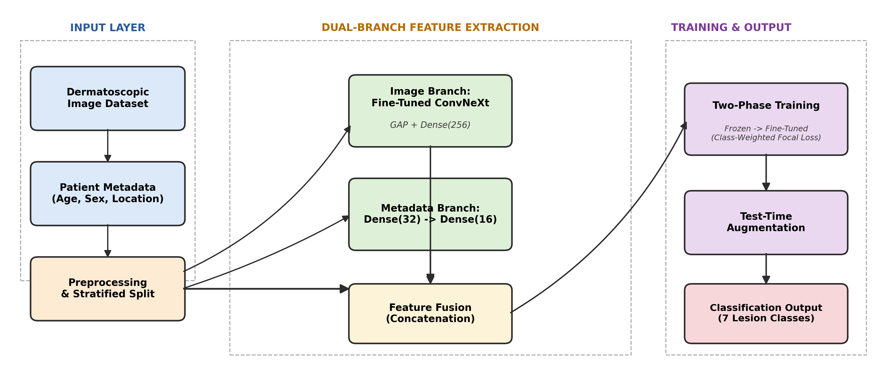
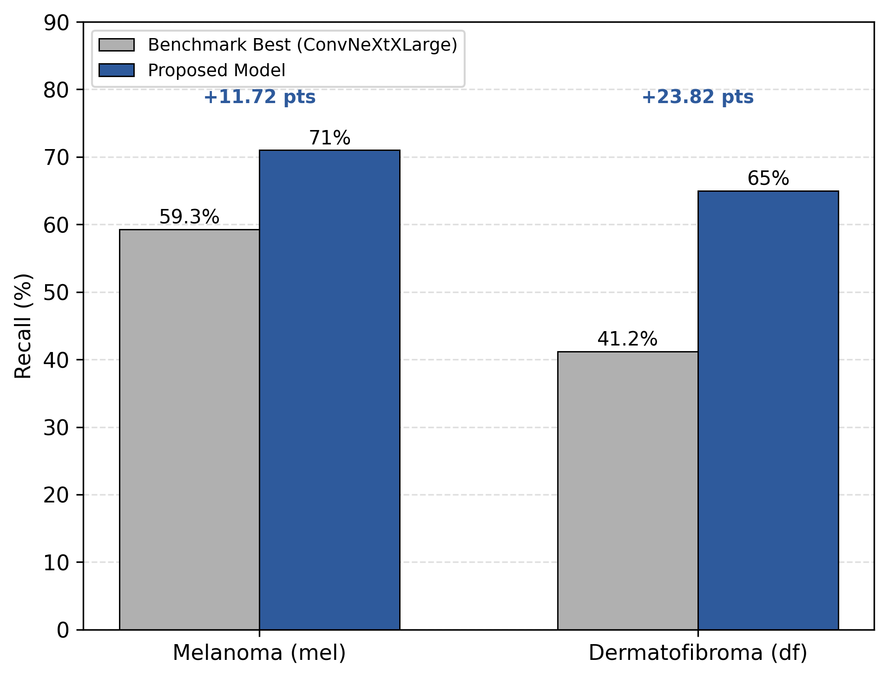
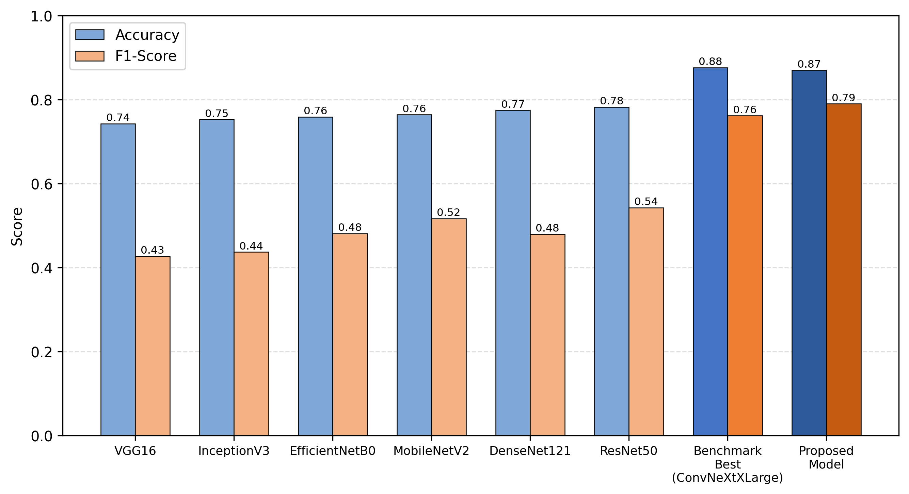
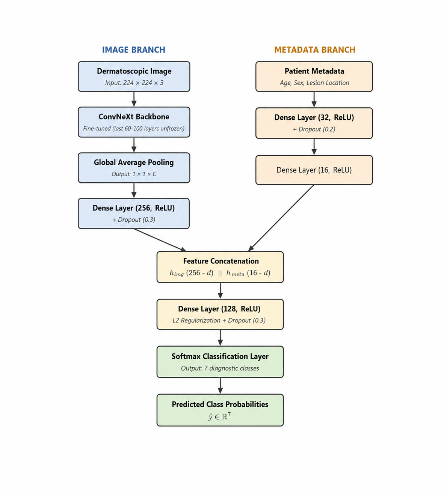
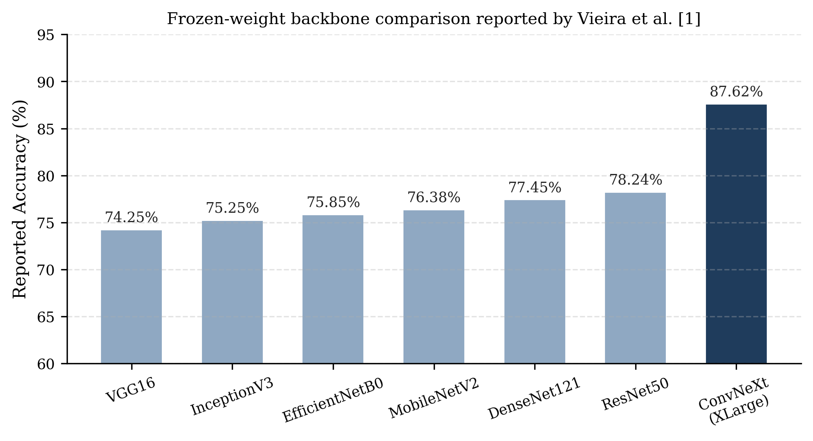
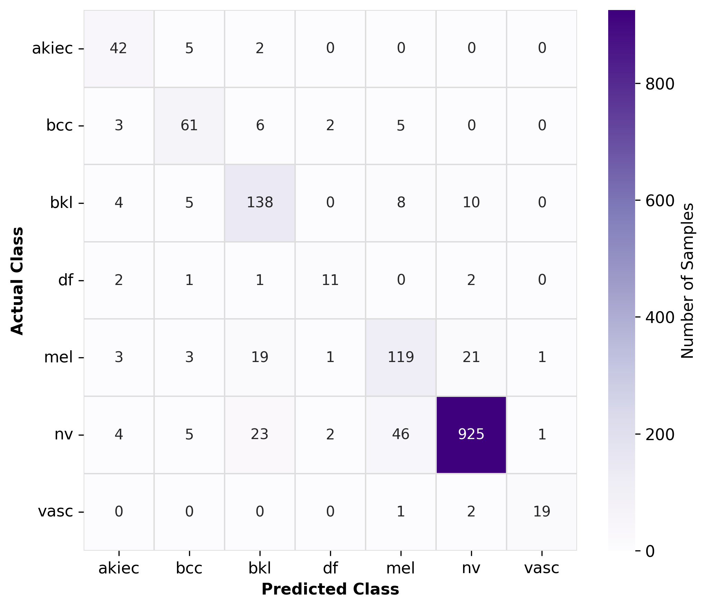

# Skin Lesion Classification — Multi-Modal CNN (HAM10000)

Classifying skin lesions into **7 diagnostic categories** from dermoscopic images — the
core work of my M.E. dissertation. Instead of looking at the image alone, the model fuses
the **image with patient metadata** (age, sex, anatomical site), and the pipeline is tuned
for the part that actually matters clinically: **recall on the rare, dangerous classes**.

[](https://github.com/Suraj-Kumar-Ray/skin-lesion-classification/actions/workflows/ci.yml)




## Results (held-out test set)

| Model | Accuracy | Macro F1 | AUC |
|---|---|---|---|
| ResNet50 — frozen, image-only (my baseline) | 0.7824 | 0.5427 | 0.9365 |
| ConvNeXtBase — image + metadata fusion | 0.8024 | 0.6937 | 0.9614 |
| **ConvNeXtLarge — fusion + fine-tune + class weights** | **0.8583** | **0.7866** | 0.9714 |
| ConvNeXtLarge — same model + test-time augmentation | 0.8563 | 0.7719 | **0.9729** |
| *Reference: best model reported in the base paper* | 0.8762 | 0.7615 | — |

Raw numbers: [`results/final-model-comparison.csv`](results/final-model-comparison.csv)

**How to read this honestly:** the final model beats the base paper on **macro F1 (+0.025)**
and **AUC**, and improves F1 by **+0.24 over my own image-only ResNet50 baseline**. Its raw
accuracy is ~1.8 points below the reference. On an imbalanced medical dataset that is the
expected trade: class weighting and fusion deliberately give up a little majority-class
accuracy to make the minority, high-risk classes much harder to miss.




## Approach

1. **Data** — HAM10000 (10,015 dermoscopic images, 7 classes). Images are split across two
   Kaggle folders, so paths are rebuilt from `image_id`.
2. **Metadata as a second input** — age, sex and localization are encoded and fed to the
   model alongside the image, so the network can combine visual evidence with context.
3. **Two-phase training** — train the classification head with a frozen ConvNeXtLarge
   backbone first, then unfreeze the last layers and fine-tune at a low learning rate.
   Class weights counter the heavy class imbalance.
4. **Test-time augmentation** — predictions are averaged over several augmented views of
   each test image, which lifts AUC to its best value.





## Repository layout

```
notebooks/
  01-ham10000-full-pipeline.ipynb          # dataset → split → baseline CNN comparison
  02-hybrid-ensemble.ipynb                 # hybrid / ensemble experiments
  03-convnextbase-fusion.ipynb             # first image + metadata fusion model
  04-convnextlarge-fusion-tta-final.ipynb  # the final model (fine-tune + class weights + TTA)
figures/           # architecture, comparison and confusion-matrix figures
results/           # final model comparison table (CSV)
```

## Running it

The notebooks were developed on Google Colab with a GPU runtime.

1. Get your own Kaggle API token (Kaggle → *Account* → *Create New Token*) and export it:
   ```bash
   export KAGGLE_TOKEN=your_token_here
   ```
   The notebooks read the token from the environment — **no credentials are stored in this repo**.
2. Download the dataset used by the notebooks: `kmader/skin-cancer-mnist-ham10000`.
3. Open the notebook you want in Colab/Jupyter and run top to bottom.

## What CI verifies

The dataset and a GPU are not available in CI, so training is not re-run there. The
workflow checks what actually rots in a notebook repository:

- every notebook is still a valid **nbformat-4** document with real code cells;
- every figure and results file linked from this README **exists**;
- `requirements.txt` still parses, and the results CSV has its accuracy / F1 / AUC columns.

Run the same check yourself: `python scripts/check_repo.py`.

## Tech

Python · TensorFlow / Keras · ConvNeXt · NumPy · pandas · scikit-learn · matplotlib · Google Colab (GPU)

---

Part of my portfolio: **[suraj-portfolio-wjpt.onrender.com](https://suraj-portfolio-wjpt.onrender.com)** ·
[LinkedIn](https://linkedin.com/in/suraj-kumar-507119203)
